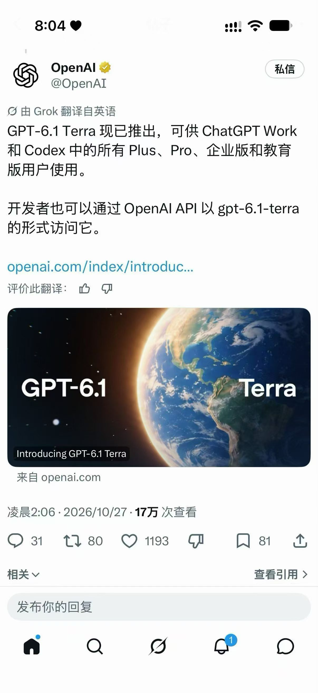
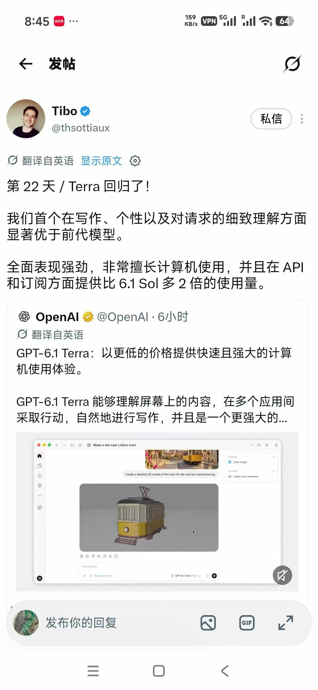

# GPT-6.1 Terra 是什么？ChatGPT Work / Codex / API 怎么用上

最近搜索里常出现 **gpt 6.1 terra**、**gpt 6 terra** 这类关键词。简单说：**GPT-6.1 Terra** 是 OpenAI 面向「会干活」场景（看屏、跨应用操作、日常公文与轻量工程）推的一档偏性价比模型；在 API 里模型 ID 为 **`gpt-6.1-terra`**。本文按教程口吻，只讲它是什么、在 ChatGPT Work / Codex / API 里怎么用上，以及怎么自己验手感。

功能、开放范围、价格一律**以 OpenAI 官方当日说明为准**；文中公开口径仅作上手对照。



---

## 1. GPT-6.1 Terra 定位一句话

| 维度 | 公开口径（摘要） |
| --- | --- |
| 产品定位 | 更快、更省的 computer use / 视觉推理 + 更自然写作 |
| 相对上一代 | 相对 **GPT-5.6 Terra** 有明显提升（官方在 Agents’ Last Exam 等评测上给出对比） |
| 相对旗舰 | 官方称在部分 Agent 任务上可与 **GPT-6 Astra** 中等努力档接近，且 **token 单价约为 Astra 的约 1/10**（公开口径，以官网价目为准） |
| 入口 | ChatGPT **Work**、**Codex**；API：`gpt-6.1-terra` |

适合先试的人：已经在用 Work / Codex 跑多步任务、或自建 Agent 看截图/点界面的开发者。不适合把它当成「最强一切」——复杂编码、极致推理仍可能要上 Sol / Astra。

---

## 2. Agents’ Last Exam：怎么理解官方说法

公开材料里，OpenAI 用 **Agents’ Last Exam**（面向专业电脑工作流的 Agent 评测）介绍 Terra，例如把建筑图纸做成 3D、逐镜头审片并写时间码日志这类任务。

需要**小心表述**的几点：

1. 分数与成本是 **OpenAI 自己跑出来的公开主张**，不是第三方独立复现结论。  
2. 「与 Astra 持平」类表述通常对应**某一努力档、某一套评测**，不要外推成「全面持平」。  
3. 「更快 / 更省」指该评测语境下的任务完成效率与估算费用，不等于任意场景的 tokens/秒。

上手建议：把官方图表当**选型线索**，用你自己的 3～5 个真实任务做 A/B，再决定默认档。

---

## 3. ChatGPT Work：怎么切到 Terra

1. 使用已开通 Plus / Pro / Enterprise / Edu 等相应权益的账号（以你订阅页当日为准）。  
2. 打开 **ChatGPT Work**（偏多步交付、可调用工具的工作流，而不是普通闲聊 Chat）。  
3. 在模型选择器里找到 **GPT-6.1 Terra**（界面文案可能写作 GPT-6.1 Terra / Terra，以客户端为准）。  
4. **新开一轮**再测，避免旧线程上下文干扰对比。

第一次验收用「真实任务」，例如：

- 给一张界面/产品参考图，让它在可用工具里完成填表、改文件、导出步骤；  
- 或：读一份短文档 → 提取字段 → 按模板输出可直接粘贴的结果。



上图这类「对着参考持续操作」的流程，比空问「你是谁」更能看出 gpt 6 terra 与上一代的差别。

---

## 4. Codex：工程向怎么用上

Codex（桌面 / Cloud 等入口以你当前客户端为准）面向写代码、改仓库、命令行任务：

1. 更新到支持新模型的 Codex / ChatGPT Desktop 版本。  
2. 在任务或会话的模型列表中选择 **GPT-6.1 Terra**。  
3. 用同一仓库任务对比：定位 bug → 改代码 → 说明改动文件；记录是否一次做完、是否乱改范围。

官方也提到：对**最复杂**的编码任务，**GPT-6.1 Sol** 与 **GPT-6 Astra** 往往仍更合适。Terra 更适合当成「日常工程吞吐默认档」来试，而不是唯一答案。

---

## 5. API：模型 ID 与调用注意

开发者在 OpenAI API 中：

- **model**：`gpt-6.1-terra`  
- 权限：控制台 / 文档当日模型列表为准  
- 对比测试：固定 system、tools、reasoning effort，只换 model  

示意（伪代码）：

```text
POST /v1/responses   # 或你当前使用的 Responses / Chat Completions 入口
{
  "model": "gpt-6.1-terra",
  "input": "……你的任务……"
}
```

跑 computer-use / Agent 时，优先用**能看截图、能调工具**的链路测；纯文本补全很难反映 Terra 主打能力。`reasoning.effort` 公开文档支持从 `none` 到 `max` 等档位（以文档当日为准），验收时至少对比 medium 与更高档各一次。

标准 API 公开价目示例（**以官网当日为准**）：约 **$1 / 1M input**、**$5 / 1M output**（另有 cached input 等细则）。

---

## 6. 五分钟验收清单

- [ ] Work / Codex 模型列表能选到 GPT-6.1 Terra  
- [ ] API 用 `gpt-6.1-terra` 能正常返回  
- [ ] 至少完成 1 个「看屏 / 跨步骤」真实任务  
- [ ] 与当前默认模型（如 Sol 或 5.6 Terra）同任务对比耗时与费用  
- [ ] 记下失败样例：拒操作、看错控件、中途停，便于改 prompt / 工具描述  

---

## 7. 小结

**GPT-6.1 Terra（`gpt-6.1-terra`）** 更适合当作 Agent / computer-use / Codex 日常干活的默认候选：网页端走 ChatGPT Work 与 Codex，开发者走 API。先用同一任务对比完成率、耗时、账单，再决定是否替换现有默认档。

Agents’ Last Exam 等数字请按「公开主张、场景相关」理解；一切以 OpenAI 官方当日页面为准。本文只做上手整理，不构成对任何第三方服务的背书。

---

## 附：本地对照环境（可选）
直连不稳或只想先摸手感时，可自行复制下列入口做对照（纯文本）：
网页对话对照：https://trygpt.asia/list/#/home
包月额度对照：https://momoai.asia/home
多模型 API 对照：https://tryallapi.com/
订阅路径对照：https://chongzhi.trygpt.asia/
与官方无关；价格以各页当日为准。
